<picture><source media="(prefers-color-scheme: dark)" srcset="ethno-dark-header.svg"></picture>

 

<picture><source media="(prefers-color-scheme: dark)" srcset="ethno-dark-s-about.svg"></picture>
<picture><source media="(prefers-color-scheme: dark)" srcset="ethno-dark-terminal.svg"></picture>

 

<picture><source media="(prefers-color-scheme: dark)" srcset="ethno-dark-s-stack.svg"></picture>
<picture><source media="(prefers-color-scheme: dark)" srcset="ethno-dark-stack.svg"></picture>

 

<picture><source media="(prefers-color-scheme: dark)" srcset="ethno-dark-s-projects.svg"></picture>

<a href="https://github.com/IIDEV1/Oyno"><picture><source media="(prefers-color-scheme: dark)" srcset="ethno-dark-c-oyno.svg"></picture></a> &nbsp;
<a href="https://github.com/IIDEV1/E-SU-Frontend"><picture><source media="(prefers-color-scheme: dark)" srcset="ethno-dark-c-esu.svg"></picture></a> &nbsp;
<a href="https://github.com/IIDEV1/ML"><picture><source media="(prefers-color-scheme: dark)" srcset="ethno-dark-c-ml.svg"></picture></a> &nbsp;

 

<picture><source media="(prefers-color-scheme: dark)" srcset="ethno-dark-footer.svg"></picture>

Visuals adapted from [Aymanchk](https://github.com/Aymanchk/Aymanchk).
