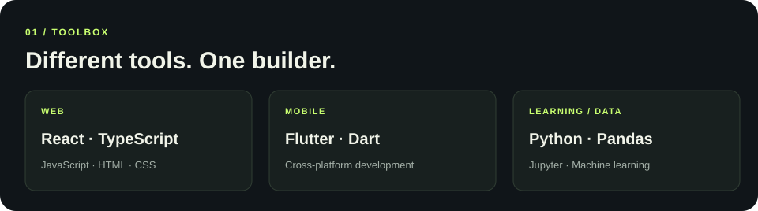
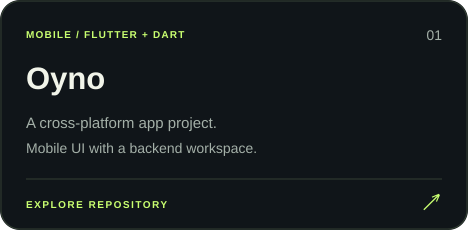
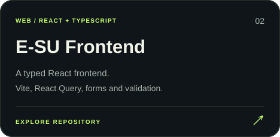
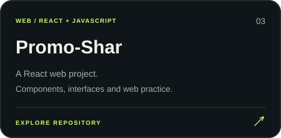
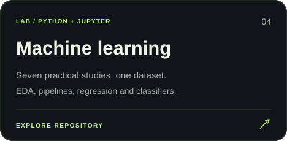
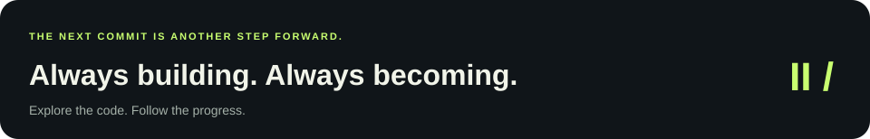

  <a href="https://github.com/IIDEV1?tab=repositories"><b>Explore my repositories ↗</b></a>
  &nbsp; · &nbsp;
  <a href="https://github.com/IIDEV1/ML">ML notebooks</a>
  &nbsp; · &nbsp;
  <a href="https://github.com/IIDEV1/Oyno">Mobile development</a>

### A little about me

I'm Islam. I build web and mobile projects and explore machine learning through hands-on practice. My repositories span React and TypeScript interfaces, Flutter apps, Python and data notebooks.

**Currently exploring:** data analysis, preprocessing pipelines, regression and classification — alongside web development and operating systems coursework.

### Selected work

  
  

  
  

<b>Inside my learning lab</b>

- [Machine learning](https://github.com/IIDEV1/ML) — seven practical studies using the Telco Customer Churn dataset, with notebooks and reports.
- [Math & data practice](https://github.com/IIDEV1/math_ml) — Pandas exercises and Google Colab notebooks.
- [Operating systems](https://github.com/IIDEV1/OS) — coursework and Python practice.

 

