<picture><source media="(prefers-color-scheme: dark)" srcset="ethno-dark-header.svg"></picture>

 

<picture><source media="(prefers-color-scheme: dark)" srcset="ethno-dark-s-about.svg"></picture>
<picture><source media="(prefers-color-scheme: dark)" srcset="ethno-dark-terminal.svg"></picture>

 

<picture><source media="(prefers-color-scheme: dark)" srcset="ethno-dark-s-stack.svg"></picture>
<picture><source media="(prefers-color-scheme: dark)" srcset="ethno-dark-stack.svg"></picture>

 

<picture><source media="(prefers-color-scheme: dark)" srcset="ethno-dark-s-projects.svg"></picture>

<a href="https://github.com/IIDEV1/Oyno"><picture><source media="(prefers-color-scheme: dark)" srcset="ethno-dark-c-oyno.svg"></picture></a> &nbsp;
<a href="https://github.com/IIDEV1/E-SU-Frontend"><picture><source media="(prefers-color-scheme: dark)" srcset="ethno-dark-c-esu.svg"></picture></a> &nbsp;
<a href="https://github.com/IIDEV1/ML"><picture><source media="(prefers-color-scheme: dark)" srcset="ethno-dark-c-ml.svg"></picture></a> &nbsp;

 

<picture><source media="(prefers-color-scheme: dark)" srcset="ethno-dark-footer.svg"></picture>

Visuals adapted from [Aymanchk](https://github.com/Aymanchk/Aymanchk).

## Portfolio highlights

I build web and mobile products and document the engineering decisions behind them. My current portfolio focuses on practical application development, backend integration, and applied machine learning.

- **[Oyno](https://github.com/IIDEV1/Oyno)** — Flutter + Django sports platform with bookings, games, chat, notifications, and API integration.
- **[E-SU Frontend](https://github.com/IIDEV1/E-SU-Frontend)** — React + TypeScript document-management frontend with authenticated and role-restricted flows.
- **[Machine Learning](https://github.com/IIDEV1/ML)** — Python/Jupyter coursework covering EDA, preprocessing, regression, classification, TF-IDF, Random Forest, threshold selection, and cross-validation.
- **[OS log-analysis project](https://github.com/IIDEV1/Module-Project-OS-)** — Linux/Python project using processes and multiple IPC approaches to analyze 600,000 web-server log records.

## Team work & contributions

I also work in shared repositories. I keep team projects separate from personal projects so reviewers can distinguish individual work from collaborative work.

- **[Oyno 2.0](https://github.com/zeuscode-tech/Oyno-2.0)** — team mobile/backend project; my Git history includes configuration/startup fixes and documentation contributions.
- **[ProphetAI](https://github.com/zeuscode-tech/ProphetAi)** — hackathon real-estate analytics project; I contributed documentation improvements that align the README with the current implementation and its limitations.

## What I care about

- Building features that can be demonstrated, not only described
- Clear setup instructions and reproducible projects
- Honest documentation of limitations and unfinished work
- Learning through real products, coursework, and team collaboration

Profile visuals are adapted from [Aymanchk](https://github.com/Aymanchk/Aymanchk).
